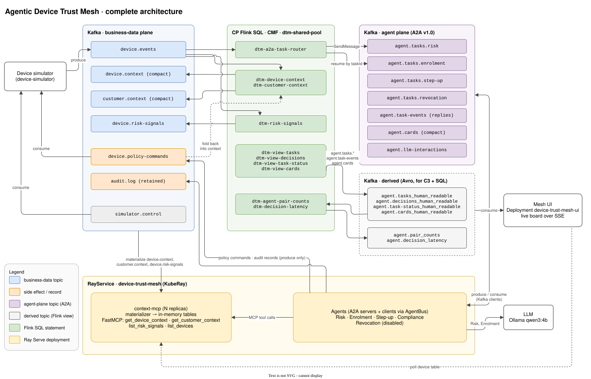
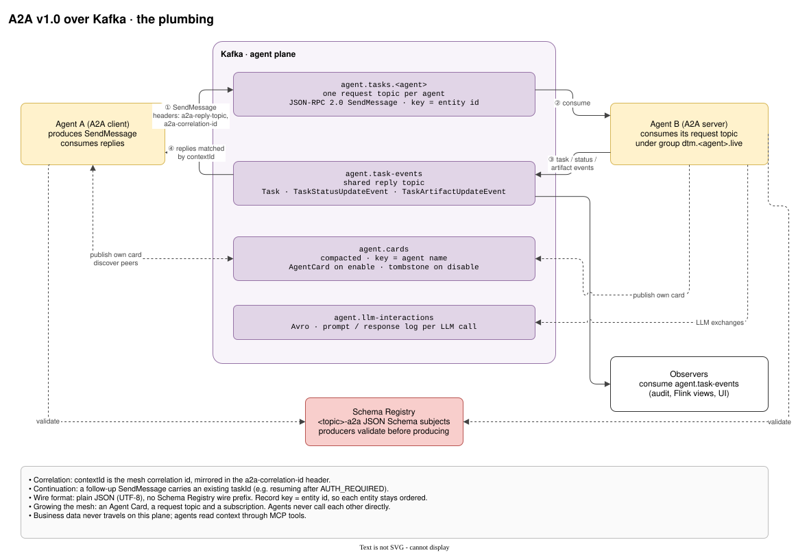
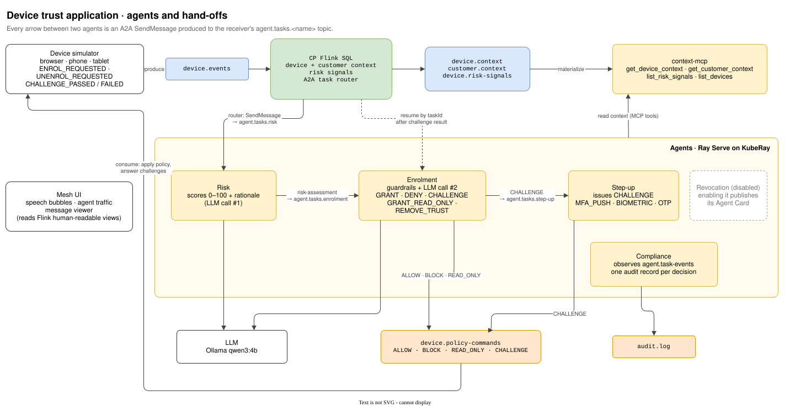

# Agentic Device Trust Mesh

An agent mesh that manages **trusted customer devices** (browsers, phones, tablets) at a large financial institution, running on Confluent Platform, CP Flink and KubeRay on the `flink-demo` cluster. Agents enrol, deny, challenge and revoke devices. Every hand-off between them is an [A2A](https://a2a-protocol.org/latest/specification/) message on Kafka, so the whole conversation is visible in Control Center and queryable from Flink SQL.

Work is tracked in [Epic #441](https://github.com/osowski/confluent-platform-gitops/issues/441). Agent, simulator and `context-mcp` source lives in [osowski/flink-sandbox `device-trust-mesh/`](https://github.com/osowski/flink-sandbox/tree/main/device-trust-mesh).

> [!NOTE]
> This workload is scaffolding. The topics, schemas, Flink tables and Flink statements deploy today, together with the runtime ConfigMaps and the Flink environment, catalog, database and shared compute pool. The `RayService` and simulator arrive with [#451](https://github.com/osowski/confluent-platform-gitops/issues/451). Measured results are marked *to be recorded*.

---

## The Pattern

| Layer | Role | Implemented by |
|---|---|---|
| **Durable coordination** | Every request, hand-off, task state change, decision, LLM exchange, side effect and audit record is a Kafka event. Agent-to-agent traffic uses **A2A v1.0 over Kafka**. Agents never call each other directly. | Confluent Platform (CFK) |
| **Trusted current context** | Device activity becomes always-current per-device and per-customer state, plus anomaly signals. | CP Flink SQL via CMF on a shared compute pool |
| **Bounded reasoning and action** | Each agent has a narrow job and a closed set of outputs, and reads business data **only** through RTCE-style MCP context tools. | Ray Serve agents on KubeRay (`RayService`) |

Context is produced by Flink, materialized for millisecond lookup, consumed by agents, and agent outcomes flow back into context. *Enterprise* here means **high-scale, low-touch**: growing the mesh is an Agent Card, a topic subscription and config, not new wiring.

### Two Planes

| Plane | Topics | How agents touch it |
|---|---|---|
| **Agent plane** (the meta-layer of agentic activity) | `agent.tasks.*`, `agent.task-events`, `agent.cards`, `agent.llm-interactions` | Kafka clients, directly, through the shared `AgentBus` wrapper |
| **Business-data plane** | `device.events`, `device.context`, `customer.context`, `device.risk-signals` | Never consumed. Read only through the `context-mcp` FastMCP tools |
| **Business side effects / records** | `device.policy-commands`, `audit.log` | Produce only |

The split follows Google's [Way Back Home Level 5 codelab](https://codelabs.developers.google.com/way-back-home-level-5/instructions) and Confluent's [Why Google's Agent2Agent Protocol Needs Apache Kafka](https://www.confluent.io/blog/google-agent2agent-protocol-needs-kafka/): A2A over Kafka for agents, with MCP kept separate for context. See [ADR-0015](../../adrs/0015-a2a-over-kafka-agent-communication.md).

---

## Architecture

Three views of the same mesh. The diagrams live in [`diagrams/`](diagrams/) as `.drawio.svg` files, which open for editing in draw.io (desktop, the VS Code extension, or [app.diagrams.net](https://app.diagrams.net)).

### Complete Architecture

Every component, topic and Flink statement, and how the business-data plane, the agent plane and the derived views connect.



### A2A Plumbing

The A2A v1.0 binding on its own, with no device-trust specifics. Any agent pair uses the same request topic, reply topic, discovery and validation. See [A2A over Kafka](#a2a-over-kafka).



### Device Trust Application

The use case: the specific agents, their hand-offs, their LLM calls and the policy commands they send back to devices. See [Agents](#agents).



### Components

| Component | Runtime | Notes |
|---|---|---|
| Device simulator | `Deployment` `device-simulator` (`replicas: 0` by default) | Produces `device.events` for a pool bounded by `DEVICE_CAP`; consumes `device.policy-commands` and `simulator.control`. |
| Flink statements | `FlinkStatement` CRs on `dtm-shared-pool` | Context, risk signals, the A2A task router, human-readable views. |
| `context-mcp` | Ray Serve deployment | Materializer + FastMCP context tools. Scale reads by adding replicas. |
| Agents | Ray Serve deployments | Risk, Enrolment, Step-up, Compliance, Revocation (disabled). |
| Mesh UI | `Deployment` `device-trust-mesh-ui` | Live board served at `https://device-trust-mesh.flink-demo.confluentdemo.local`. Reads the human-readable and aggregate topics and polls `context-mcp`; see [UI](#ui). |
| KubeRay operator | [`kuberay-operator`](../kuberay-operator/) Application (wave 117, opt-in) | Provides `ray.io/RayService`. |
| LLM | Native macOS Ollama (default) or in-cluster Ollama | Same pattern as [Flink Agents](../flink-agents/README.md). |

---

## A2A over Kafka

A2A v1.0 defines JSON-RPC, gRPC and HTTP+JSON transports but no Kafka binding, so the mesh defines one.

| A2A concept | Kafka mapping |
|---|---|
| Server endpoint | Request topic `agent.tasks.<agent>`, consumed under group `dtm.<agent>.live` |
| `SendMessage` | JSON-RPC 2.0 request object as the record value; non-blocking |
| Responses | `Task`, `TaskStatusUpdateEvent` and `TaskArtifactUpdateEvent` on the topic in the `a2a-reply-topic` header, which is the shared `agent.task-events` |
| Correlation | `contextId` = mesh correlation id, mirrored in the `a2a-correlation-id` header |
| Task continuation | A follow-up `SendMessage` carrying an existing `taskId` |
| Discovery | `AgentCard` per agent on compacted `agent.cards` (key = agent name): published when the agent is enabled, tombstoned when disabled |
| Record key | `device_id` (per-device ordering); agent name on `agent.cards` |
| Wire format | Plain JSON (UTF-8), **no** Schema Registry wire prefix. Producers validate against the topic's `<topic>-a2a` subject before producing |

### Record Shapes

Field names are protojson camelCase and enums are strings (`ROLE_USER`, `TASK_STATE_COMPLETED`). Optional members are omitted, never `null`.

| Topic | Record value |
|---|---|
| `agent.tasks.<agent>` | `{"jsonrpc":"2.0","id":<messageId>,"method":"SendMessage","params":{"message":{…}}}`. The `message` carries `messageId`, `contextId`, `role`, `extensions: ["urn:device-trust-mesh:envelope:v1"]`, `metadata` with the envelope, `parts`, and optionally `taskId` and `referenceTaskIds` |
| `agent.task-events` | `{"jsonrpc":"2.0","id":<request id>,"result":{…}}`, where `result` holds exactly one of `task`, `statusUpdate` or `artifactUpdate`, each with the envelope in its own `metadata` |
| `agent.cards` | An A2A `AgentCard`. `supportedInterfaces[0]` is `{"url":"kafka://kafka.kafka.svc.cluster.local:9071/agent.tasks.<name>","protocolBinding":"urn:device-trust-mesh:kafka:v1","protocolVersion":"1.0"}`, and `capabilities.extensions` lists the envelope URI |

**Part order is part of the binding.** On every request message and every artifact, `parts[0]` is the typed `data` part (`"mediaType":"application/json"`) and `parts[1]` is a `text` summary. The JSON Schemas pin the order with `prefixItems`, and the Flink tables and views read the parts by position.

### Payloads

`parts[0].data` per topic and artifact name. Required fields are **bold**.

| Payload | Carried on | Fields |
|---|---|---|
| `AssessEnrolmentRequest` | `agent.tasks.risk` | **deviceId**, **customerId**, **requiredContextSeq**, **fingerprintSummary** |
| `DecideEnrolmentRequest` | `agent.tasks.enrolment` | **taskType** (`DECIDE_ENROLMENT` / `REMOVE_TRUST` / `RESOLVE_CHALLENGE`), **deviceId**, customerId, riskAssessment {score, rationale, signalIds[], llmInteractionId}, enrolmentTaskId, challengeResult (`PASSED` / `FAILED`) |
| `StepUpRequest` | `agent.tasks.step-up` | **enrolmentTaskId**, **reason**, signalIds[] |
| `RevocationRequest` | `agent.tasks.revocation` | **deviceId**, **reason** |
| `risk-assessment` | `agent.task-events` artifact | **score** (0–100), **rationale**, **signalIds[]**, **asOf** {contextSeq, materializedAt (epoch millis), sourceOffsets [{topic, partition, offset}]} |
| `enrolment-decision` | `agent.task-events` artifact | **outcome** (`GRANTED` / `DENIED` / `CHALLENGED` / `READ_ONLY` / `REMOVED`), **policyAction** (`ALLOW` / `BLOCK` / `READ_ONLY` / `CHALLENGE`), **rationale**, riskScore, guardrails[], asOf |
| `step-up-challenge` | `agent.task-events` artifact | **method** (`MFA_PUSH` / `BIOMETRIC` / `OTP`), **enrolmentTaskId** |
| `audit-record` | `agent.task-events` artifact | **auditId**, **subjectTaskId** |

The `agent.task-events` schema selects the artifact payload by `artifact.name`.

### Envelope

The mesh envelope rides inside A2A's own extension points. Messages declare `extensions: ["urn:device-trust-mesh:envelope:v1"]`, and the envelope lives under that key in `metadata` on `Message`, `Task` and the update events. Each message carries one typed `data` part plus a `text` part with a readable summary.

| Field | Meaning |
|---|---|
| `messageId` | Deterministic for agent outputs: UUIDv5 of `(agent_id, causation_id, config_version, output_index)` |
| `contextId` | Correlation id minted by the simulator when a device flow starts (`ENROL_REQUESTED`, `UNENROL_REQUESTED`); later events in the flow, such as a challenge result, echo it |
| `taskId` | Deterministic: UUIDv5 of `(agent_id, first input messageId)` |
| `referenceTaskIds` | Task(s) that caused this one |
| `causationId` | `messageId` of the message that caused this one |
| `agentId` / `agentVersion` | `flink:<statement>` or `agent:<name>`; image tag or statement name |
| `configVersion` | Hash of the effective agent config and prompts |
| `eventTime` | Producer-assigned epoch millis |
| `deviceId`, `customerId`, `deviceSeq`, `requiredContextSeq` | Filtering and the context watermark |
| `mode`, `replayRunId` | `LIVE` / `REPLAY` |

The envelope's `messageId` and `correlationId` equal the record's A2A `messageId` and `contextId` where those exist, so every envelope is self-contained; status and artifact events have no A2A `messageId` of their own. Kafka headers mirror `a2a-correlation-id`, `a2a-message-id`, `a2a-reply-topic`, `dtm-agent-id` and `dtm-mode`. Business-plane Avro records carry the same envelope as a typed `envelope` field, so device events, context, the A2A conversation and the audit trail all join on the correlation id.

Ids that a Flink statement derives are a `DTM_ID`: the SHA-1 of the statement name and the record's identifying inputs joined with `|`, laid out as a UUID (`h[1..8]-h[9..12]-5h[14..16]-8h[18..20]-h[21..32]`). The `5` and `8` give it the UUIDv5 shape, but it is not an RFC 9562 UUIDv5, because no namespace is hashed. A `DTM_ID` is a fingerprint. The same inputs always give the same id, so consumers dedupe and cross-reference on it: a risk assessment's `signalIds[]` match `signal_id` in `device.risk-signals`. Nothing can be decoded from the id, and the meaning is in the record's own fields. Each statement's inputs are listed with that statement in this README and in `base/flink-statements.yaml`.

### Task Lifecycle

Each agent owns one A2A `Task` per request:

`TASK_STATE_SUBMITTED` → `TASK_STATE_WORKING` → artifact (`risk-assessment`, `enrolment-decision`, `step-up-challenge`, `audit-record`) → `TASK_STATE_COMPLETED`.

A guardrail denial ends in `TASK_STATE_REJECTED`. While a step-up challenge is outstanding, the enrolment task waits in `TASK_STATE_AUTH_REQUIRED`. The challenge result resumes it by `taskId`.

---

## Context Engine (RTCE Parallel)

Confluent Cloud's Real-Time Context Engine keeps a materialized table per topic and serves millisecond lookups to agents over MCP. `context-mcp` is the Confluent Platform + KubeRay equivalent. See [ADR-0014](../../adrs/0014-rtce-style-context-engine-on-cp-kuberay.md).

- **Materializer.** Each replica loads `device.context`, `customer.context` and the last 50 `device.risk-signals` per device into memory. It uses manual partition assignment from the earliest offset, with offsets held alongside the data. A replica reports ready only after catching up.
- **Kafka is the durable store.** The compacted context topics keep the latest value per key indefinitely. A restart re-reads them, which takes seconds at demo scale.
- **Tools** (FastMCP, streamable HTTP, at `device-trust-mesh-serve-svc:8000/context-mcp/mcp`):

  | Tool | Returns |
  |---|---|
  | `get_device_context(device_id, min_seq?)` | Device context + `as_of` |
  | `get_customer_context(customer_id)` | Customer context incl. device list |
  | `list_risk_signals(device_id, limit?)` | Recent risk signals |
  | `list_devices(customer_id?, trust_status?)` | Scan (bounded by `DEVICE_CAP`) |

- **Watermark.** `min_seq` waits up to 2 s for the replica to reach the device's `requiredContextSeq`, then returns `STALE`, which agents retry. Agents copy `as_of` into their decision artifacts.

> [!NOTE]
> **Production.** A production deployment would add persistent backing to the serving layer: a snapshot plus stored offsets, so a restart resumes from the snapshot instead of re-reading every topic. See [#458](https://github.com/osowski/confluent-platform-gitops/issues/458).

---

## Topic and Schema Catalogue

Kubernetes object names can't contain `_`, so each `KafkaTopic` uses a DNS-safe `metadata.name` and puts the real topic in `spec.name`. All topics have 3 replicas.

| Topic (`spec.name`) | `metadata.name` | Plane | Format | Partitions | Cleanup / retention |
|---|---|---|---|---|---|
| `device.events` | `device-events` | business | Avro | 6 | delete, 7d |
| `device.context` | `device-context` | business | Avro | 6 | compact |
| `customer.context` | `customer-context` | business | Avro | 6 | compact |
| `device.risk-signals` | `device-risk-signals` | business | Avro | 6 | delete, 7d |
| `device.policy-commands` | `device-policy-commands` | side effect | Avro | 6 | delete, 7d |
| `audit.log` | `audit-log` | record | Avro | 6 | delete, retained indefinitely |
| `agent.tasks.risk` | `agent-tasks-risk` | agent | A2A JSON | 6 | delete, 7d |
| `agent.tasks.enrolment` | `agent-tasks-enrolment` | agent | A2A JSON | 6 | delete, 7d |
| `agent.tasks.step-up` | `agent-tasks-step-up` | agent | A2A JSON | 6 | delete, 7d |
| `agent.tasks.revocation` | `agent-tasks-revocation` | agent | A2A JSON | 6 | delete, 7d |
| `agent.task-events` | `agent-task-events` | agent | A2A JSON | 6 | delete, 7d |
| `agent.cards` | `agent-cards` | agent | A2A JSON | 1 | compact |
| `agent.llm-interactions` | `agent-llm-interactions` | agent | Avro | 6 | delete, 7d |
| `agent.tasks_human_readable` | `agent-tasks-human-readable` | derived | Avro | 6 | delete, 7d |
| `agent.decisions_human_readable` | `agent-decisions-human-readable` | derived | Avro | 6 | delete, 7d |
| `agent.task-status_human_readable` | `agent-task-status-human-readable` | derived | Avro | 6 | delete, 7d |
| `agent.cards_human_readable` | `agent-cards-human-readable` | derived | Avro | 1 | compact |
| `agent.pair_counts` | `agent-pair-counts` | derived | Avro | 1 | delete, 1d |
| `agent.decision_latency` | `agent-decision-latency` | derived | Avro | 6 | delete, 7d |
| `simulator.control` | `simulator-control` | control | Avro | 1 | delete, 1d |

### Schemas

Every subject is a CFK `Schema` CR (wave 35) in [`base/schemas.yaml`](base/schemas.yaml), backed by a generated ConfigMap. 23 subjects in all, `BACKWARD` compatibility:

| Topics | Subjects | Format | Producer wire format |
|---|---|---|---|
| All business and derived topics | `<topic>-value` | Avro, namespace `io.confluent.dtm` | Schema Registry (Avro serializer) |
| `device.context`, `customer.context`, `agent.cards_human_readable` | also `<topic>-key`: a record holding `device_id` / `customer_id` / `agent` | Avro | Schema Registry |
| `agent.tasks.*`, `agent.task-events`, `agent.cards` | `<topic>-a2a` | JSON Schema draft 2020-12 | Plain JSON |

- **Avro.** Every value schema starts with the shared `envelope` record, except the flat `agent.pair_counts-value` and `agent.decision_latency-value`. Enums cover the closed sets (`EventType`, `PolicyAction`, `TrustStatus`, `SignalType`, `Severity`, `Mode`, …). Fields written by Flink are nullable, except in those two flat records: all of `agent.pair_counts` is non-null, and so are `device_id`, `correlation_id`, `event_time`, `decision_time` and `latency_ms` in `agent.decision_latency`. Key fields live only in the `-key` subject, so inferred column names never collide.
- **A2A.** Schemas are derived from the pinned A2A v1.0.1 JSON Schema bundle. Each is narrowed to the mesh binding: the JSON-RPC wrapper, envelope metadata required, `parts` pinned to `[data, text]`, and `data` typed per topic or per artifact name. The snake_case aliases are dropped because the mesh emits camelCase only.
- **Why `-a2a` and not `-value`.** The Flink catalog only infers tables from `<topic>-value`, and CMF can't map JSON Schema tuple arrays (`prefixItems`). A `-value` subject would make the catalog fail to load the table at all. Under `-a2a` the A2A tables infer as `raw` instead (see [Tables](#tables)).

Schemas are generated, never hand-edited:

| Path | Contents |
|---|---|
| `schemas/upstream/a2a-v1.0.1.json` | Unmodified bundle from `https://a2a-protocol.org/v1.0.1/spec/a2a.json`. The generator checks its SHA-256 |
| `schemas/src/avro/*.avsc` | Avro sources. `envelope.avsc` is inlined wherever a field has type `io.confluent.dtm.Envelope` |
| `schemas/src/a2a/*.json` | The envelope and payload JSON Schemas used to narrow A2A |
| `base/schemas/{avro,a2a}/*` | Generated output, committed, consumed by `configMapGenerator` |

```bash
python3 -I scripts/generate-dtm-schemas.py           # regenerate base/schemas/
python3 -I scripts/generate-dtm-schemas.py --check   # exit 1 and list drifted files
python3 -I -m unittest discover -s scripts/tests -v  # generator tests
```

---

## Flink

The object chain mirrors [Colors and Shapes](../colors-and-shapes/README.md): `dtm-env` → `dtm-catalog` → `dtm-database` → `dtm-shared-pool` → `FlinkStatement`s, in namespace `device-trust-mesh`. `spec.statement` is immutable once running, so SQL changes ship as new versioned statements (`-v2`).

### Shared Compute Pool

Every statement runs on **`dtm-shared-pool` (`type: SHARED`)**: one long-lived Flink session cluster, sized at JM 1 GiB plus one 4.5 GiB TaskManager with 12 slots (3 CPU), which covers the ten long-running statements at parallelism 1 with two slots spare. That replaces one dedicated cluster per statement. Shared pools fit many low-throughput queries, and they keep statement state across stop/resume on CMF ≥ 2.4.2 (this repo runs 2.4.4).

- `spec.type` can't be changed after creation.
- Pool updates are blocked while any statement on the pool is `PENDING`, `RUNNING`, `STOPPED` or `FAILING`.
- If one statement starves the others, move it to its own `DEDICATED` pool with a new versioned statement.
- Checkpoints run every 10 s (`execution.checkpointing.interval`, 5 s `min-pause`). Kafka sinks commit on checkpoint, so this bounds how soon `read_committed` consumers see each statement's output (see **Committed visibility** under [Statements](#statements)).

#### Growing the shared pool

Resizing `dtm-shared-pool` (slots, CPU or memory in [`base/flink-compute-pool.yaml`](base/flink-compute-pool.yaml)) is a pool update, so it is rejected while any statement is in a blocking state (listed above). Roll it out in this order:

1. Delete the long-running `FlinkStatement`s in `device-trust-mesh`. Leave the `dtm-ddl-*` ones: a `COMPLETED` DDL does not block the update, and a deleted one is re-created by Argo CD and fails because its columns already exist.

   ```bash
   kubectl get flinkstatements -n device-trust-mesh -o name | grep -v 'dtm-ddl-' | xargs kubectl delete -n device-trust-mesh
   ```

2. Wait until `kubectl get flinkstatements -n device-trust-mesh` lists only `dtm-ddl-*` statements and all of them are `COMPLETED`. A leftover `FAILED` `dtm-ddl-*` also blocks the update and survives the `grep -v`; recover it as described in the [`base/flink-ddl.yaml`](base/flink-ddl.yaml) header first.
3. Sync the `device-trust-mesh` Application. The Application is manual-sync, so nothing re-creates the statements before this. The pool updates at wave 60, then the statements are re-created at wave 70.
4. Check that the new TaskManager has the new slot count and that every long-running statement returns to `RUNNING`.

Deleting a statement discards its state, and it restarts from its configured start offsets. The re-created `dtm-view-*` statements re-emit their backlog into the `*_human_readable` topics, so a running UI shows a burst of historical feed rows and counts it as live traffic in busiest pairs. Restart the UI once the backlog drains, or run [`reset-session.sh`](#resetting-for-a-fresh-session) instead when the history does not need to survive.

### Tables

`dtm-catalog` infers one table per topic from its Schema Registry subjects. The `dtm-ddl-*` statements (wave 65, in [`base/flink-ddl.yaml`](base/flink-ddl.yaml)) each run one `ALTER TABLE … ADD` and finish `COMPLETED`.

| Table | Structure | Key / changelog | Added by `dtm-ddl-*` |
|---|---|---|---|
| `device.events` | Inferred Avro | raw `key`, append | `kafka_partition`, `kafka_offset` (metadata), `proc_time AS PROCTIME()` |
| `device.policy-commands`, `device.risk-signals`, `audit.log`, `agent.llm-interactions`, `simulator.control`, `agent.decisions_human_readable`, `agent.task-status_human_readable`, `agent.pair_counts`, `agent.decision_latency` | Inferred Avro | raw `key`, append | — |
| `agent.tasks_human_readable` | Inferred Avro | raw `key`, append | `proc_time AS PROCTIME()` |
| `device.context`, `customer.context`, `agent.cards_human_readable` | Inferred Avro with a typed key | PK `device_id` / `customer_id` / `agent`, upsert | — |
| `agent.tasks.{risk,enrolment,step-up,revocation}` | `raw` `key` / `val` + computed columns | raw `key`, append | `headers MAP<STRING, BYTES> METADATA`, task columns, `proc_time` |
| `agent.task-events` | `raw` + computed columns | raw `key`, append | event columns, `proc_time` |
| `agent.cards` | `raw` + computed columns | PK `key`, upsert (compacted) | card columns |

Computed columns are `JSON_VALUE` / `JSON_QUERY` over `CAST(val AS STRING)`. `env_event_time`, `env_device_seq` and `env_required_context_seq` are `BIGINT` via `TRY_CAST(JSON_VALUE(…) AS BIGINT)`, so text that is not a plain number (an ISO timestamp, or a float that `JSON_VALUE` renders as `1.79332393777E12`) becomes `NULL` instead of failing the job (the views drop a record with a `NULL` `env_event_time` and pass a `NULL` sequence through); `*_json` and `reference_task_ids` hold JSON text; everything else is `STRING`:

- **Task tables:** `rpc_id`, `rpc_method`, `message_id`, `context_id`, `task_id`, `role`, `reference_task_ids`, `data_json` (`parts[0].data`), `summary` (`parts[1].text`), and the 13 envelope fields as `env_message_id` … `env_replay_run_id`.
- **`agent.task-events`:** `rpc_id`, `kind` (`task` / `statusUpdate` / `artifactUpdate`), `task_id`, `context_id`, `state`, `status_time` (ISO-8601 string), `status_text`, `artifact_id`, `artifact_name`, `artifact_data_json`, `artifact_text`, and the 13 `env_*` columns. Each is coalesced across the three result shapes.
- **`agent.cards`:** `card_name`, `card_version`, `card_description`, `skills_json` (skill names), `interface_url`, `protocol_binding`.

A DDL statement runs once and its CR is immutable. Re-creating it against a table that already has the columns fails, so table changes ship as a new `-v2` DDL CR that alters only the delta. If a `dtm-ddl-*` CR is deleted, Argo CD re-creates it and it fails; the recovery (drop the CR's columns, then re-sync) is in the [`base/flink-ddl.yaml`](base/flink-ddl.yaml) header.

### Statements

| Statement | Input → Output | Logic | Story |
|---|---|---|---|
| `dtm-device-context` | `device.events` ∪ `device.policy-commands` → `device.context` | Latest fingerprint, last geo, `context_seq` (max `device_seq`), `trust_status` | [#447](https://github.com/osowski/confluent-platform-gitops/issues/447) |
| `dtm-customer-context` | same → `customer.context` | Device count, trusted device count (latest action `ALLOW`), known countries, distinct non-`ALLOW` command count | [#447](https://github.com/osowski/confluent-platform-gitops/issues/447) |
| `dtm-risk-signals` | `device.events` ∪ `device.policy-commands` (`ALLOW`) → `device.risk-signals` | `COMPROMISED_OS`, `OUTDATED_OS`, `NEW_DEVICE_ESTABLISHED_ACCOUNT`, `IMPOSSIBLE_TRAVEL` (thresholds below) | [#448](https://github.com/osowski/confluent-platform-gitops/issues/448) |
| `dtm-a2a-task-router` | `device.events` → `agent.tasks.risk`, `agent.tasks.enrolment` | The bank's A2A client: builds `SendMessage` requests | [#449](https://github.com/osowski/confluent-platform-gitops/issues/449) |
| `dtm-view-tasks` | `agent.tasks.*` → `agent.tasks_human_readable` | Unnests JSON-RPC and `parts` | [#450](https://github.com/osowski/confluent-platform-gitops/issues/450) |
| `dtm-view-decisions` | `agent.task-events` → `agent.decisions_human_readable` | One row per artifact | [#450](https://github.com/osowski/confluent-platform-gitops/issues/450) |
| `dtm-view-task-status` | `agent.task-events` → `agent.task-status_human_readable` | One row per state change | [#450](https://github.com/osowski/confluent-platform-gitops/issues/450) |
| `dtm-view-cards` | `agent.cards` → `agent.cards_human_readable` | Flattened Agent Cards | [#450](https://github.com/osowski/confluent-platform-gitops/issues/450) |
| `dtm-agent-pair-counts` | `agent.tasks_human_readable` → `agent.pair_counts` | Request count per agent pair in 5-minute windows sliding every 5 seconds | [#473](https://github.com/osowski/confluent-platform-gitops/issues/473) |
| `dtm-decision-latency` | `agent.decisions_human_readable` ⋈ `agent.tasks_human_readable` → `agent.decision_latency` | Router task to decision, in milliseconds | [#473](https://github.com/osowski/confluent-platform-gitops/issues/473) |

The context statements ([`base/flink-statements.yaml`](base/flink-statements.yaml), wave 70) are pure `GROUP BY` aggregates:

- **Ordering.** `LAST_VALUE` follows arrival order across the two input topics, not event time. That is acceptable at demo rates. Event times (`last_event_time`, `envelope.event_time`) use `MAX`, because `LAST_VALUE` does not accept `TIMESTAMP_LTZ` on Flink 1.19.
- **`trust_status`** comes from the device's latest policy command:

  | Latest command | `trust_status` |
  |---|---|
  | `ALLOW` | `TRUSTED` |
  | `READ_ONLY` | `READ_ONLY` |
  | `CHALLENGE` | `CHALLENGED` |
  | `BLOCK`, reason `UNENROLLED` | `UNENROLLED` |
  | other `BLOCK` | `BLOCKED` |
  | none yet, `ENROL_REQUESTED` seen | `PENDING` |
  | none yet, no enrolment request | `UNKNOWN` |

- **Command-only devices.** A device with commands but no events still gets a `device.context` row. Its fingerprint, geo and `context_seq` are null and its envelope comes from the latest command.
- **Commands carry `customer_id`.** Every `device.policy-commands` record an agent produces must carry `envelope.customer_id`; `dtm-customer-context` ignores a command without one (it never counts toward `trusted_device_count` or `recent_anomaly_count`), and so does the `NEW_DEVICE_ESTABLISHED_ACCOUNT` check in `dtm-risk-signals`.
- **Duplicate commands.** `recent_anomaly_count` counts distinct non-`ALLOW` command message ids, so a re-produced command is counted once.
- **Intermediate counts.** One command can change both of a customer's counts. `customer.context` may then briefly show an in-between pair within one commit (for example `recent_anomaly_count` rises before `trusted_device_count` falls). The pair converges.
- **State TTL.** Statement state expires after 7 days without input for a key (`table.exec.state.ttl`). After more than 7 days without commands for a device, that device can stay counted in `trusted_device_count`, and the device's `trust_status` reverts once its next event arrives.
- **No tombstones.** Neither statement writes tombstones to the compacted topics: every update is an upsert. The header comment in `base/flink-statements.yaml` explains how.

`dtm-risk-signals` (same file, wave 70) appends one `device.risk-signals` record per anomaly, keyed by `device_id`:

| Signal | Severity | Fires when |
|---|---|---|
| `COMPROMISED_OS` | `HIGH` | `fingerprint.rooted` is true |
| `OUTDATED_OS` | `MEDIUM` | OS major version below **17** on `IOS` or **13** on `ANDROID` (an unparseable version raises nothing) |
| `NEW_DEVICE_ESTABLISHED_ACCOUNT` | `MEDIUM` | `ENROL_REQUESTED` with `account_age_days` above **90** and at least one *other* device of the customer already `ALLOW`ed within the state TTL. A device blocked after its `ALLOW` still counts. An `ALLOW` without `envelope.customer_id` is ignored, so it never counts as another device of the customer |
| `IMPOSSIBLE_TRAVEL` | `HIGH` | Haversine distance from the customer's previous event (within the state TTL) above **900 km/h** of elapsed `envelope.event_time`; elapsed time must be at least **1 s**, since it is counted in whole seconds |

- **Ordering.** "Previous" and "already" mean processed earlier (processing time). A replay, backfill or re-read from the earliest offset can interleave events and commands differently from the live run, so it can omit, or newly add, `NEW_DEVICE_ESTABLISHED_ACCOUNT` and `IMPOSSIBLE_TRAVEL` signals.
- **State TTL.** Window state expires after 7 days without input (`table.exec.state.ttl`):
  - `NEW_DEVICE_ESTABLISHED_ACCOUNT` only remembers `ALLOW`s inside that window. An established customer whose only `ALLOW` is older than 7 days raises no signal.
  - The per-device and per-customer states expire independently, so a device's own re-enrolment after expiry can be miscounted as another device's `ALLOW`.
  - `IMPOSSIBLE_TRAVEL` has no previous event after 7 idle days for the customer.
- **Ids.** `signal_id` (also `envelope.message_id`) is a `DTM_ID` over `dtm-risk-signals|<signal_type>|<causing event message_id>`; that `message_id` is also the signal's `causation_id`. It is deterministic per (signal type, causing event), so consumers dedupe duplicates on `signal_id`. The envelope `event_time` is the causing event's.
- **Committed visibility.** CMF Kafka sinks are transactional, so a `read_committed` consumer sees a statement's output only once that statement's checkpoint commits, and each Flink hop adds up to about one checkpoint interval (10 s on `dtm-shared-pool`) of latency. `device.context` and `device.risk-signals` are produced by separate statements that commit independently, so reaching the context watermark (`requiredContextSeq`) does not guarantee the matching risk signal is visible yet. [#468](https://github.com/osowski/confluent-platform-gitops/issues/468) tracks tightening this.

`dtm-a2a-task-router` (same file, wave 70) is the bank's A2A client. It is one `EXECUTE STATEMENT SET` with one `INSERT` per request topic, and it writes one plain-JSON `SendMessage` request per routed device event, keyed by `device_id`:

| Device event | Request topic | `parts[0].data` | `message.taskId` | `parts[1].text` |
|---|---|---|---|---|
| `ENROL_REQUESTED` with `customer_id` and `device_seq` | `agent.tasks.risk` | `AssessEnrolmentRequest`: `deviceId`, `customerId`, `requiredContextSeq` = `device_seq`, `fingerprintSummary` (`IOS 18.1, rooted=false, network=WIFI, country=GB`) | absent | `Assess enrolment risk for <device> (customer <customer>)` |
| `UNENROL_REQUESTED` | `agent.tasks.enrolment` | `DecideEnrolmentRequest` `REMOVE_TRUST`: `deviceId`, `customerId` (if known) | absent | `Remove trust for <device>` |
| `CHALLENGE_PASSED` / `CHALLENGE_FAILED` with an `enrolment_task_id` | `agent.tasks.enrolment` | `DecideEnrolmentRequest` `RESOLVE_CHALLENGE`: `deviceId`, `customerId` (if known), `enrolmentTaskId`, `challengeResult` `PASSED` / `FAILED` | `enrolment_task_id` | `Resolve challenge <result> for <device> (enrolment task <id>)` |

- **Not routed.** An `ENROL_REQUESTED` without `customer_id` or `device_seq`, because `AssessEnrolmentRequest` requires both. A challenge result without an `enrolment_task_id` (null or empty), because there is no task to resume.
- **Ids.** `messageId` is the JSON-RPC `id`, `params.message.messageId` and the envelope `messageId`. It is `DTM_ID` over `dtm-a2a-task-router|device.events|<partition>|<offset>` of the causing event. A router restart from its checkpoint reproduces the same ids, and a re-produced event lands at a new offset and gets a new id. Agents are stateless per message, so a `-v2` must not start from the earliest offset, where they would re-run every historical request: start it from `latest-offset` (or the old statement's offsets) and keep the `dtm-a2a-task-router` literal in the id input, so any overlap reproduces the same ids.
- **Envelope.** `agentId` `flink:dtm-a2a-task-router`, `agentVersion` `dtm-a2a-task-router`, `configVersion` `n/a`. `contextId` and `correlationId` come from the event's `correlation_id`, `causationId` from its `message_id`, and `eventTime` from its `event_time` (epoch millis). `requiredContextSeq` and `deviceSeq` both carry the event's `device_seq`, which is the `device.context` `context_seq` an agent waits for before it reads context. `customerId`, `deviceSeq`, `requiredContextSeq` and `replayRunId` are left out when the event has no value. Members are never `null`, and `taskId` is never empty.
- **Challenge events.** A `RESOLVE_CHALLENGE` request carries `taskId` = `enrolment_task_id` and `contextId` = the challenge event's `correlation_id`, and A2A requires them to match the task's context. A `CHALLENGE_PASSED` / `CHALLENGE_FAILED` event must therefore echo the enrolment's `correlation_id`, as it echoes `enrolment_task_id`.
- **Headers.** `a2a-correlation-id` (the `contextId`), `a2a-message-id` (the `messageId`), `a2a-reply-topic` (`agent.task-events`), `dtm-agent-id` (`flink:dtm-a2a-task-router`) and `dtm-mode` (the event's `mode`).
- **Validation.** Flink writes the raw topics without validating against the `<topic>-a2a` subjects. The SQL builds each request to match `agent.tasks.risk-a2a` / `agent.tasks.enrolment-a2a`, and nothing downstream re-validates it, so check the output of any `-v2` against those subjects (for example with `kafka-json-schema-console-producer` and `json.fail.invalid.schema=true`).

The `dtm-view-*` statements (same file, wave 70) flatten the A2A topics into the Avro `*_human_readable` topics for Control Center and ad-hoc SQL:

| View | One row per | Columns after `envelope` |
|---|---|---|
| `agent.tasks_human_readable` | `SendMessage` request on `agent.tasks.*` | `from_agent`, `to_agent` (the request topic's agent), `task_type`, `task_id`, `message_id`, `reference_task_ids` (JSON array text), `summary` (`parts[1].text`) |
| `agent.decisions_human_readable` | `artifactUpdate` on `agent.task-events` | `agent`, `task_id`, `artifact_name`, `outcome`, `policy_action`, `risk_score` (`score` or `riskScore`; `NULL` when not a number in `INT` range, a decimal truncates), `rationale`, `signal_ids` (JSON array text), `method` |
| `agent.task-status_human_readable` | `task` or `statusUpdate` on `agent.task-events` | `agent`, `task_id`, `state` (`TASK_STATE_*`), `status_time` (the A2A ISO-8601 string), `status_text` |
| `agent.cards_human_readable` (upsert, key `agent`) | agent with a current Agent Card | `version`, `description`, `skills` (JSON array text of skill names), `request_topic`, `protocol_binding` |

- **`task_type`.** `ASSESS_ENROLMENT` on `agent.tasks.risk` and `STEP_UP` on `agent.tasks.step-up`. On `agent.tasks.enrolment` and `agent.tasks.revocation` it is the payload's `taskType`, defaulting to `DECIDE_ENROLMENT` and `REVOKE`.
- **Agent names.** `from_agent` and `agent` are the envelope `agentId` without its `agent:` / `flink:` prefix, so router requests show `dtm-a2a-task-router`.
- **Envelope and key.** The three append views copy the A2A record's envelope (`event_time` converted from epoch millis) and are keyed by its `deviceId`.
- **Duplicates.** Each source is deduplicated on its message id (`messageId` on requests, the envelope `messageId` on `agent.task-events`), keeping the first copy, so an at-least-once redelivery or a re-produced record adds no row. Dedupe state expires 7 days after an id's first copy (`table.exec.state.ttl`); a duplicate after that adds a row. A `-v2` of an append view that reads from the earliest offset starts with empty dedupe state, so it writes every row again.
- **Malformed records.** A record missing a required envelope field, or with a `mode` other than `LIVE` / `REPLAY`, produces no row. A request without a `messageId` produces no row either. The statements keep running.
- **Cards.** `agent.cards_human_readable` follows the compacted `agent.cards`: a new card upserts its agent's row and a card tombstone deletes it. An Agent Card has no envelope, so the view writes one: `message_id` and `correlation_id` are a `DTM_ID` over the statement name, agent and card JSON, `agent_id` is `flink:dtm-view-cards`, `event_time` is the card record's Kafka timestamp, `device_id` is `n/a` and `mode` is `LIVE`.
- **Cards state.** `dtm-view-cards` runs without a state TTL. The upsert source keeps each agent's last card in state, and a tombstone that arrives after that state has expired is dropped, which would leave a disabled agent's row behind. The state is one row per agent.

`dtm-agent-pair-counts` and `dtm-decision-latency` (same file, wave 70) write the aggregates the Device Trust Mesh UI reads:

| Topic | One row per | Fields | Key |
|---|---|---|---|
| `agent.pair_counts` | (`from_agent`, `to_agent`) pair per window | `window_start`, `window_end` (`timestamp-millis`), `from_agent`, `to_agent`, `message_count` | `from_agent\|to_agent` (raw bytes) |
| `agent.decision_latency` | decision artifact joined to a router task | `device_id`, `customer_id`, `correlation_id`, `device_seq`, `agent`, `task_id`, `artifact_name`, `outcome`, `policy_action`, `rationale`, `event_time` (the task's), `decision_time` (the decision's), `latency_ms` | `device_id` (raw bytes) |

- **Pair counts window.** A processing-time window from the `HOP` table function (5 minutes, sliding every 5 seconds) over a CTE of `agent.tasks_human_readable` that keeps the source hint (the CTE sits in a derived table, since an `INSERT` body must be a plain `SELECT`), on `proc_time`, added by `dtm-ddl-agent-tasks-human-readable`. It needs no watermark and buckets a request by when Flink reads it, not when the agent sent it. The source reads from `latest-offset`, so a restart does not replay history into the current windows. Rows without a `from_agent` or `to_agent` are not counted.
- **Latency join.** A regular inner join with a 1 h state TTL (`table.exec.state.ttl`). Both sources read from the earliest offset. It joins on `device_id` and `device_seq` and keeps only tasks with `from_agent` `dtm-a2a-task-router`, because the router's request starts a device's leg. `correlation_id` alone would be wrong: one correlation id spans every request and decision in a conversation, so a decision would join to each task sharing it and the latency would be measured from the wrong start.
- **`latency_ms`.** The decision's `envelope.event_time` minus the task's, in epoch millis. Every artifact matching a router task is written, so consumers filter on `artifact_name` (the UI keeps `enrolment-decision`).
- **Duplicates.** It reads both views from `earliest-offset` with no dedupe, so after a statement restart or pool rollout it re-emits the backlog. Consumers must tolerate duplicate rows.

### Ad-hoc Queries

Run these from the Flink SQL shell or the CMF UI against `dtm-catalog`.`dtm-database`:

```sql
-- Decisions for one device
SELECT envelope.device_id, agent, outcome, policy_action, risk_score, rationale
FROM `agent.decisions_human_readable`
WHERE envelope.device_id = 'dev-0007';

-- The A2A requests in one conversation (correlation id = the device event's correlation_id)
SELECT envelope.event_time, from_agent, to_agent, task_type, summary
FROM `agent.tasks_human_readable`
WHERE envelope.correlation_id = '<correlation id>';

-- A task's state changes, in order
SELECT envelope.event_time, agent, state, status_time, status_text
FROM `agent.task-status_human_readable`
WHERE task_id = '<task id>';

-- Which agents are in the mesh right now
SELECT agent, version, description, request_topic FROM `agent.cards_human_readable`;
```

`agent.cards_human_readable` is an upsert table, so a streaming query over it returns a changelog: a disabled agent's row arrives and is then retracted. The materialized result lists only the current agents.

---

## Device Cap

`DEVICE_CAP` in ConfigMap `device-trust-mesh-config` (default **20**) is the upper bound on unique device ids in a run. It is the only place to set it.

- The simulator draws ids from the fixed pool `dev-0001..dev-<DEVICE_CAP>`, so it can't exceed the cap.
- The `mesh-runtime` component's Kustomize `replacements` copy the value into the simulator and into the Ray head and worker containers.
- `context-mcp` exports `dtm_tracked_devices` and flags `dtm_device_cap_exceeded`.
- Partition counts are fixed at 6 and support caps up to 500. Agent replicas must stay ≤ 6.

---

## Agents

| Agent | Phase 1 | Consumes | Produces | LLM |
|---|---|---|---|---|
| Risk | Enabled | `agent.tasks.risk` | `risk-assessment` artifact, `SendMessage` → enrolment, LLM log | Score 0–100 + rationale |
| Enrolment | Enabled | `agent.tasks.enrolment` | `enrolment-decision` artifact, `SendMessage` → step-up, policy commands, LLM log | `DECIDE_ENROLMENT` only |
| Step-up | Enabled | `agent.tasks.step-up` | `step-up-challenge` artifact, `CHALLENGE` command | No |
| Compliance | Enabled | `agent.task-events` (observer) | `audit.log`, `audit-record` artifact | No |
| Revocation | **Disabled** | `agent.tasks.revocation` | decisions, policy commands | Placeholder |

Enabling Revocation publishes its Agent Card to `agent.cards`, which is the live "expand the mesh" moment. Routing work to it is [#457](https://github.com/osowski/confluent-platform-gitops/issues/457).

**Enrolment guardrails.**
- Before the LLM: `COMPROMISED_OS` → `DENY` without calling it, and an already-trusted device → idempotent `GRANT`.
- After the LLM: the output must be schema-valid with an allowed outcome, and `GRANT` above the risk threshold is coerced to `CHALLENGE`.
- Guardrail firings are recorded in the decision artifact.

### Phase 1 Enrolment Flow

Every arrow between agents is a Kafka hand-off: the sender produces an A2A `SendMessage` to the receiver's `agent.tasks.<name>`, and the receiver consumes it under its own group.

1. The simulator produces `ENROL_REQUESTED` to `device.events`.
2. Flink updates `device.context` / `customer.context`, emits any risk signals, and the router sends `SendMessage` to `agent.tasks.risk`.
3. **Risk** reads context through `context-mcp` and makes LLM call #1. It reports its task and `risk-assessment` on `agent.task-events`, then sends `SendMessage` to `agent.tasks.enrolment`.
4. **Enrolment** applies the guardrails and makes LLM call #2: `GRANT`, `DENY`, `CHALLENGE` or `GRANT_READ_ONLY`.
   - Non-challenge outcomes produce `ALLOW`, `BLOCK` or `READ_ONLY` to `device.policy-commands`.
   - `CHALLENGE` sets the task to `AUTH_REQUIRED` and sends `SendMessage` to `agent.tasks.step-up`.
5. **Step-up** sends a `CHALLENGE` policy command (`MFA_PUSH`, `BIOMETRIC` or `OTP`).
6. The simulator answers with `CHALLENGE_PASSED` or `CHALLENGE_FAILED`. The router resumes the enrolment task by `taskId`, and it ends in `ALLOW` or `BLOCK`.
7. **Compliance** writes one `audit.log` record per decision artifact. Flink folds the policy command back into `device.context.trust_status`.

**Unenrolment** is straight-through: `UNENROL_REQUESTED` → Enrolment (`REMOVE_TRUST`, deterministic) → `BLOCK` (reason `UNENROLLED`) → audit.

---

## Configuration Reference

All set per overlay.

| ConfigMap | Key | Default | Purpose |
|---|---|---|---|
| `device-trust-mesh-config` | `DEVICE_CAP` | `"20"` | Upper bound on unique devices per run |
| `device-trust-mesh-config` | `LLM_ENDPOINT` | `http://host.docker.internal:11434` | Interpolated into `agents.yaml` |
| `device-trust-mesh-agents` | `agents.yaml` | see below | LLM, per-agent enablement, bus and context settings |
| `device-trust-mesh-prompts` | `risk.v1`, `enrolment.v1`, `revocation.v1` | none (the prompts packaged in the image) | A key overrides the packaged prompt of that name |

```yaml
llm:
  provider: ollama                 # ollama | openai-compatible | recorded (replay)
  endpoint: ${LLM_ENDPOINT}
  model: qwen3:4b
  options: { temperature: 0, seed: 42, think: false, num_ctx: 4096 }
agents:
  risk:       { enabled: true,  replicas: 1, promptRef: risk.v1,       llm: {} }  # llm: per-agent override
  revocation: { enabled: false, replicas: 1, promptRef: revocation.v1, llm: {} }
bus:
  startPosition: committed         # committed | earliest | offset | timestamp (replay)
  topicPrefix: ""                  # replay sets "replay.<run-id>."
  policyCommands: enabled          # enabled | redirect | disabled
  allowedConsume: [ "agent.tasks.<self>", "agent.task-events", "agent.cards" ]
```

- Agents reload these files at a message boundary, with no pod restart. Each output, and the agent's Agent Card, carries the resulting `configVersion`.
- `enabled: false` pauses the agent and tombstones its card.
- `replicas` maps to the Serve `num_replicas` in the `RayService`.

| Component | Effect |
|---|---|
| `components/mesh-runtime` | Adds the `RayService` (`device-trust-mesh-ray`, Ray 2.59.0) and the simulator (`device-trust-mesh-simulator`), and the `DEVICE_CAP` replacements. Included in `flink-demo`; it needs `kuberay-operator` applied first. |
| `components/ollama-in-cluster-mode` | Switches `LLM_ENDPOINT` to `http://ollama.ollama.svc.cluster.local:11434` |

### Model Recommendation

Every agent uses the same Ollama model. The default is **`qwen3:4b`** with `think: false`; turning off Qwen3's thinking mode matters more for latency than model size. The fallback is **`qwen3:8b`**, the model [Flink Agents](../flink-agents/README.md) uses. `temperature: 0`, a fixed `seed` and schema-constrained output (`format`) keep decisions reproducible.

Measured on an Apple M5 Max (36 GB) with native Ollama 0.35.0, using the base options above. Each scenario ran 10 times: `CLEAN` plus the four injected scenarios, built from the facts the agents send. The benchmark is [`scripts/benchmark_models.py`](https://github.com/osowski/flink-sandbox/blob/main/device-trust-mesh/scripts/benchmark_models.py) in `flink-sandbox`.

| Model | Risk p50 / p95 | Enrolment p50 / p95 | Schema-valid rate |
|---|---|---|---|
| `qwen3:4b` | 480 / 788 ms | 656 / 781 ms | 100% (90/90) |
| `qwen3:8b` | 610 / 840 ms | 736 / 875 ms | 100% (90/90) |

Both models give the same enrolment decisions except in one scenario, `NEW_DEVICE_ESTABLISHED_ACCOUNT`. There `qwen3:4b` scores the device 0 and decides `GRANT`, and `qwen3:8b` scores it 25 and decides `CHALLENGE`. Because the risk assessment carries the signal, the `UNRESOLVED_SIGNALS` guardrail still turns the `qwen3:4b` `GRANT` into `CHALLENGE`. `qwen3:4b` stays the default: it is about 20% faster at the same schema-valid rate, and the guardrails cover its weaker scoring.

---

## Running It

1. **Start native Ollama** and pull the model. See [Flink Agents: Ollama on the native macOS host](../flink-agents/README.md#option-1-ollama-on-the-native-macos-host-global-default):
   ```bash
   brew services run ollama
   ollama pull qwen3:4b
   ```
2. **Free resources** by suspending `colors-and-shapes` and `flink-agents` if they are running.
3. **Apply the KubeRay operator** (opt-in):
   ```bash
   kubectl apply -f clusters/flink-demo/workloads/kuberay-operator.yaml -n argocd
   kubectl get crd rayservices.ray.io
   ```
4. **Apply and sync the workload** (manual sync):
   ```bash
   kubectl apply -f clusters/flink-demo/workloads/device-trust-mesh.yaml -n argocd
   kubectl patch application device-trust-mesh -n argocd --type merge -p '{"operation":{"sync":{"syncStrategy":{"hook":{}}}}}'
   ```
   On a cluster that was bootstrapped before `device-trust-mesh` joined the Flink Kubernetes Operator's `watchNamespaces`, restart the operator once so it watches the new namespace. Otherwise the shared pool's `FlinkDeployment` never gets pods. See [Adding Applications](../../docs/adding-applications.md#2-flink-kubernetes-operators-watchnamespaces):
   ```bash
   kubectl rollout restart deployment/flink-kubernetes-operator -n operator
   ```
5. **Verify:**
   ```bash
   kubectl get kafkatopic -n device-trust-mesh
   kubectl get flinkenvironment,flinkkafkacatalog,flinkkafkadatabase,flinkcomputepool -n device-trust-mesh
   kubectl get schema -n device-trust-mesh          # 23 subjects, STATUS SUCCEEDED
   kubectl get flinkstatement -n device-trust-mesh  # dtm-ddl-* COMPLETED, the 10 long-running statements RUNNING
   kubectl get pods -n device-trust-mesh    # shared-pool JobManager; TaskManagers start once statements run
   kubectl get rayservice device-trust-mesh -n device-trust-mesh   # Ready once all six Serve apps run
   ```
6. **Watch the mesh:**
   - Control Center topic browser: `agent.tasks.*`, `agent.task-events`, `*_human_readable`
   - The Ray dashboard and `context-mcp` (see [Inspecting the Mesh](#inspecting-the-mesh))
   - The ad-hoc queries above

   Scale `device-simulator` to 1 to start a run.

The full Phase 1 acceptance run is [#453](https://github.com/osowski/confluent-platform-gitops/issues/453).

### Resetting for a Fresh Session

Before a session, empty everything an audience can see (devices, the traffic feed, busiest pairs and latencies) while keeping the topics, schemas, Agent Cards, the `dtm-ddl-*` statements and the agents:

```bash
./workloads/device-trust-mesh/reset-session.sh --dry-run   # show the plan
./workloads/device-trust-mesh/reset-session.sh             # type 'reset' to confirm, or pass --yes
```

The script only runs against the `kind-flink-demo` kube context; set `DTM_RESET_CONTEXT` to use another.

**What it does, in order:**
1. Scales the simulator to 0.
2. Deletes the long-running statements.
3. Purges every session topic in place with `kafka-delete-records`. The compacted `device.context` and `customer.context` topics switch to `compact,delete` for the purge, because Kafka refuses to delete records from a compaction-only topic.
4. Restarts the Ray pods so context-mcp reloads empty tables, then purges again to catch in-flight agent writes.
5. Runs the manual `device-trust-mesh` sync. This recreates the statements and returns the topic policies to what git declares.
6. Restarts the UI.

The statements restart against empty topics, so there is no backlog to re-read. A run takes a few minutes, most of it waiting for CMF and Ray. It ends by checking that context-mcp lists no devices and that the UI reports nothing stale. The simulator stays at 0, so start the session with `kubectl -n device-trust-mesh scale deploy device-simulator --replicas=1`.

### Inspecting the Mesh

**Ray dashboard.** The KubeRay operator has no UI of its own; it only reconciles the `RayService` and `RayCluster` resources. The Ray dashboard runs on the Ray head node:

```bash
kubectl -n device-trust-mesh port-forward svc/device-trust-mesh-head-svc 8265:8265
```

At `http://localhost:8265`:

| Tab | Shows |
|---|---|
| **Serve** | The six applications (`context-mcp` and the five agents), each with its deployments, replica count, health and per-replica logs |
| **Cluster** | The head and worker nodes, with CPU and memory use |
| **Actors** / **Logs** | Every Serve replica's process, and stdout/stderr per node |

Without the dashboard, `kubectl -n device-trust-mesh get rayservice device-trust-mesh -o yaml` shows each Serve application's status under `.status`.

**`context-mcp` directly.** The context engine serves a REST mirror of its MCP tools, and requests from localhost are allowed:

```bash
kubectl -n device-trust-mesh port-forward svc/device-trust-mesh-serve-svc 8000:8000

curl -s localhost:8000/context-mcp/v1/devices | jq                       # every device (filters: ?customer_id=&trust_status=)
curl -s localhost:8000/context-mcp/v1/devices/<device_id> | jq           # one device's context + as_of
curl -s "localhost:8000/context-mcp/v1/devices/<device_id>?min_seq=N"    # waits up to 2 s for that context sequence
curl -s localhost:8000/context-mcp/v1/customers/<customer_id> | jq       # customer context incl. device list
curl -s "localhost:8000/context-mcp/v1/devices/<device_id>/signals?limit=10" | jq
curl -s localhost:8000/context-mcp/healthz                               # 503 until the materializer has caught up
```

To query it the way the agents do, point an MCP client at `http://localhost:8000/context-mcp/mcp` (streamable HTTP) through the same port-forward. For example, `npx @modelcontextprotocol/inspector` opens a browser UI that lists and calls the four tools: `get_device_context`, `get_customer_context`, `list_risk_signals` and `list_devices`.

---

## UI

A live board at `https://device-trust-mesh.flink-demo.confluentdemo.local` (add the host to `/etc/hosts` with `./scripts/generate-hosts-entries.sh flink-demo`). The `ui` component deploys the `device-trust-mesh-ui` Deployment and Service, and the Certificate and IngressRoute live in [`workloads/ingresses/overlays/flink-demo`](../ingresses/overlays/flink-demo/). It requires the `mesh-runtime` component, because the device table comes from `context-mcp`. The service source is in [osowski/flink-sandbox `device-trust-mesh/dtm/ui`](https://github.com/osowski/flink-sandbox/tree/main/device-trust-mesh/dtm/ui).

The page has four panes, left column over right:

| Pane | Shows | Source |
|---|---|---|
| **Devices · live** (top left) | Per device: customer, trust status, decision reason, time of last change, event-to-decision latency and freshness. A summary row sits above the table. | `context-mcp` poll, `agent.decision_latency` |
| **Busiest agent pairs** (bottom left) | Messages per 60 s, averaged over the last 5 minutes, for each source and target pair, with a bar and a sparkline. | `agent.pair_counts` |
| **Agent traffic** (top right) | A graph of the agents with a moving dot per message, and a feed of source, target, kind, device and `topic @ partition:offset`. Clicking an edge filters the feed. Compliance replies read `compliance → audit log`. | `agent.tasks_human_readable`, `agent.task-status_human_readable`, `agent.decisions_human_readable` |
| **Agent activity** (bottom right) | One card per agent with a speech bubble for its latest outgoing message: who it went to, the customer, the device and the action, tinted by policy action and held for at least 4 s. Hovering a bubble highlights that device's row. | `agent.tasks_human_readable`, `agent.decisions_human_readable` |

Clicking a bubble or a feed row opens the **message viewer**, which shows that message's human-readable row as sent over Kafka. The UI holds the most recent 500. **What am I looking at?** in the header opens an explainer for presenting the use case: the executive summary, the agents and their Kafka hand-offs, and the complete architecture.

Two latencies are shown for each device:

| Latency | Measures |
|---|---|
| **Event to decision** | Time from the device event to the `enrolment-decision` artifact, from `dtm-decision-latency`. |
| **Freshness** | How long `context-mcp` took to reflect the change in the context table, measured at a 500 ms poll interval. |

The UI reads every topic with `read_committed`, and Flink Kafka sinks commit on checkpoint. `dtm-shared-pool` checkpoints every 10 s, so each Flink hop makes its output visible in batches about 10 s apart, and a decision shows up on the board within about 10-15 s. The UI adds no delay of its own. The browser never polls: the service pushes each change over Server-Sent Events, which Traefik streams without a buffering middleware.

---

## Replay Design

Replaying one agent from a chosen point in the stream is a later phase ([#454](https://github.com/osowski/confluent-platform-gitops/issues/454)). The architecture already supports it:

| Requirement | How |
|---|---|
| Kafka is the source of truth | Agents are stateless per message; challenge tasks resume by `taskId`; `context-mcp` rebuilds from topics |
| Envelope on every message | A2A `metadata` extension, enforced by `AgentBus` |
| Determinism | `temperature: 0`, `seed`, deterministic `messageId` / `taskId`, `configVersion` |
| Recorded LLM responses | `agent.llm-interactions`, keyed by `request_hash`; a `RecordedProvider` replays them |
| Replay window | 7d retention on inputs, compacted context topics, `audit.log` kept indefinitely |
| Separate consumer group | `dtm.<agent>.<mode>[.<run-id>]` |
| Replay-namespaced outputs | `bus.topicPrefix: "replay.<run-id>."`; replay requests name a prefixed `a2a-reply-topic` |
| Side effects | `bus.policyCommands: enabled \| redirect \| disabled` |

**Seeking.** `bus.startPosition: offset` assigns explicit `(partition, offset)` pairs. `bus.startPosition: timestamp` resolves a wall-clock time per partition with the consumer's `offsetsForTimes` and seeks there. Both run under the replay consumer group, so production offsets are never touched.

## Later Phases

- **External A2A gateway:** an HTTP/JSON-RPC A2A endpoint mapping external `SendMessage` calls onto `agent.tasks.*` ([#456](https://github.com/osowski/confluent-platform-gitops/issues/456)).
- **Mesh expansion:** route compromised trusted devices to the Revocation agent ([#457](https://github.com/osowski/confluent-platform-gitops/issues/457)).

## References

- [A2A protocol specification (v1.0)](https://a2a-protocol.org/latest/specification/)
- [Way Back Home Level 5 codelab (A2A over Kafka)](https://codelabs.developers.google.com/way-back-home-level-5/instructions)
- [Why Google's Agent2Agent Protocol Needs Apache Kafka](https://www.confluent.io/blog/google-agent2agent-protocol-needs-kafka/)
- [ADR-0014: RTCE-style context engine on CP + KubeRay](../../adrs/0014-rtce-style-context-engine-on-cp-kuberay.md)
- [ADR-0015: A2A v1.0 over Kafka](../../adrs/0015-a2a-over-kafka-agent-communication.md)
- [Bootstrap procedure: live-testing a branch](../../docs/bootstrap-procedure.md#live-testing-an-unmerged-branch-on-a-cluster)
